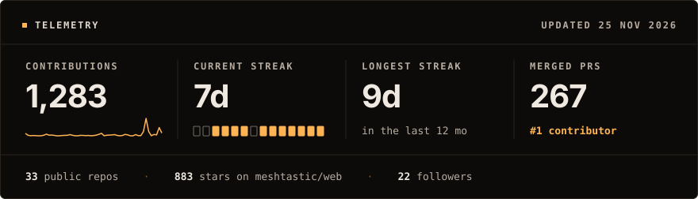
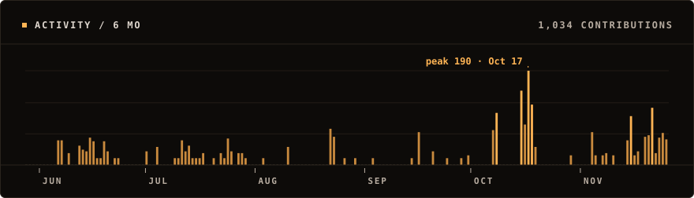
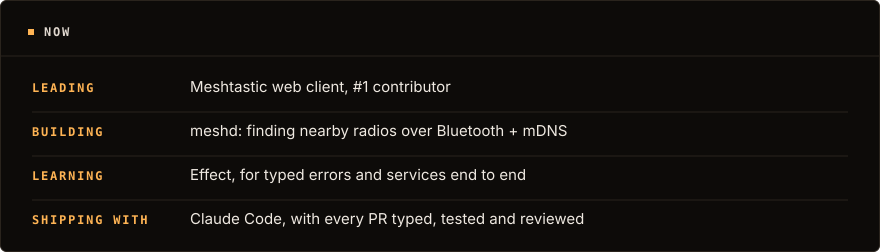
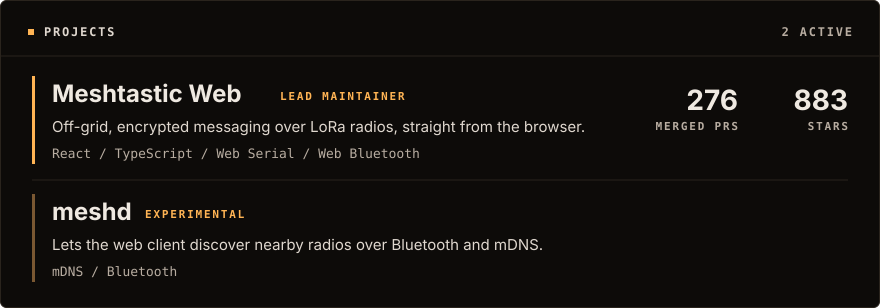
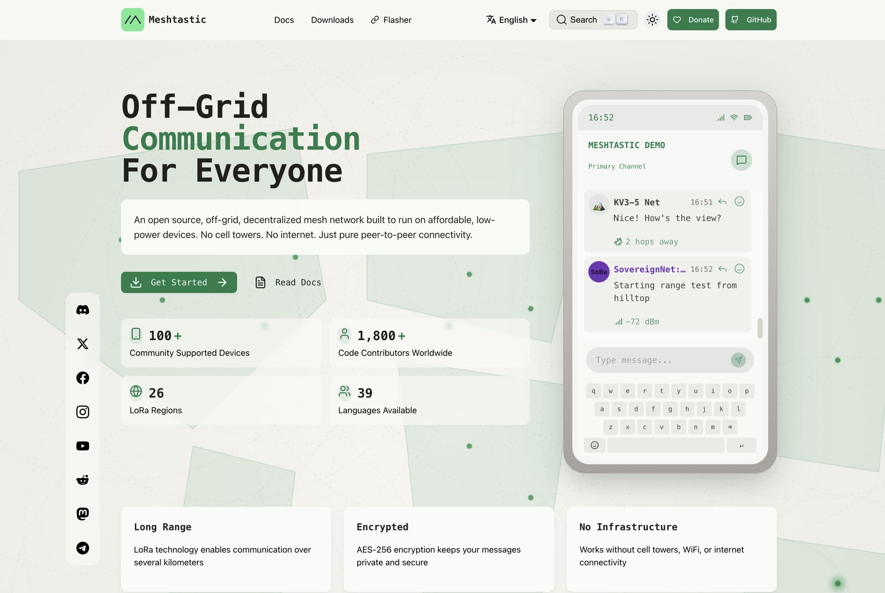

<a href="https://github-profile-views.dandcodes.workers.dev/go/meshtastic-web">Meshtastic Web</a> · <a href="https://github-profile-views.dandcodes.workers.dev/go/meshd">meshd</a> · <a href="https://github-profile-views.dandcodes.workers.dev/go/site">danditomaso.com</a> · cards redrawn nightly by a GitHub Action

## Past work

### Meshtastic homepage redesign

**Before** ([archived January 19, 2026](https://web.archive.org/web/20260119205752/https://meshtastic.org/))

**After** ([live now](https://github-profile-views.dandcodes.workers.dev/go/meshtastic-org))

<a href="https://github-profile-views.dandcodes.workers.dev/go/meshtastic-org">
  <picture>
    <source media="(prefers-color-scheme: dark)" srcset="assets/meshtastic-homepage-dark.jpg">
    
  </picture>
</a>

I redesigned [meshtastic.org](https://github-profile-views.dandcodes.workers.dev/go/meshtastic-org) ([#2204](https://github-profile-views.dandcodes.workers.dev/go/meshtastic-pr), January 2026), replacing the stock Docusaurus landing page with a custom one:

- An animated mesh-network background and a phone mockup that plays a simulated mesh chat
- Animated project stats, feature highlights, platform downloads and a sponsor marquee
- Reusable Radix UI components and a Tailwind design system with light and dark themes

## What I care about

Type-safe code from UI to API, interfaces that stay fast as apps grow, secure-by-default web apps, and tests and tooling that let teams ship with confidence. Lately I've been digging into [Effect](https://effect.website) and [Rust](https://rustfoundation.org).

I use AI coding agents (Claude Code, Copilot) day to day and maintain the agent guidance for the Meshtastic web client ([`CLAUDE.md`](https://github.com/meshtastic/web/blob/main/CLAUDE.md)). I treat AI output like any other PR: typed, tested, and reviewed before it ships.

**Languages & frameworks:** TypeScript · Python · React · Next.js · Node.js · Hono · Express · GraphQL · REST 
**Data & testing:** PostgreSQL · MongoDB · SQLite · Redis · Vitest · Jest · Playwright · Cypress 
**Cloud & delivery:** AWS · Google Cloud · Azure · Docker · Vercel · CI/CD · monorepos

Outside of code you'll find me rock climbing or playing ultimate frisbee.

---

Open to new opportunities, so feel free to [reach out](https://github-profile-views.dandcodes.workers.dev/go/email).

[danditomaso.com](https://github-profile-views.dandcodes.workers.dev/go/site) · [LinkedIn](https://github-profile-views.dandcodes.workers.dev/go/linkedin) · [Email](https://github-profile-views.dandcodes.workers.dev/go/email)

