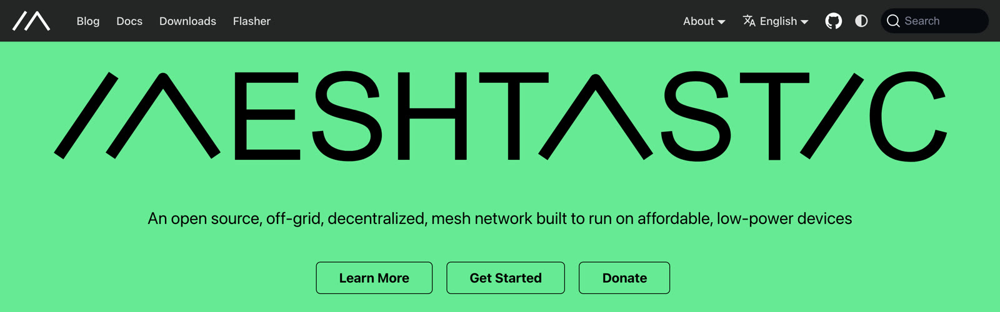

# Hey, I'm Dan 👋

**Senior full-stack engineer with a focus on the frontend.** I build web apps with **React and TypeScript**, along with any of the infrastructure behind them.

I lead the [Meshtastic web client](https://github.com/meshtastic/web), the open-source browser app for [Meshtastic](https://meshtastic.org): off-grid, encrypted messaging over affordable LoRa radios. No cell towers, no internet. The web client connects to radios over HTTP, Bluetooth and USB serial, straight from the browser.

## What I'm working on

| | |
|---|---|
| 📡 **[Meshtastic Web](https://github.com/meshtastic/web)** | The web client and its TypeScript packages for talking to Meshtastic radios. I'm its top contributor and lead the project. |
| 🔎 **[meshd](https://github.com/danditomaso/meshtastic-meshd)** | A small Rust service that lets the web client discover nearby radios over Bluetooth and mDNS. *Experimental.* |

## Past work

### Meshtastic homepage redesign

**Before** ([archived January 19, 2026](https://web.archive.org/web/20260119205752/https://meshtastic.org/))

**After** ([live now](https://meshtastic.org))

<a href="https://meshtastic.org">
  <picture>
    <source media="(prefers-color-scheme: dark)" srcset="assets/meshtastic-homepage-dark.jpg">
    
  </picture>
</a>

I redesigned [meshtastic.org](https://meshtastic.org) ([#2204](https://github.com/meshtastic/meshtastic/pull/2204), January 2026), replacing the stock Docusaurus landing page with a custom one:

- An animated mesh-network background and a phone mockup that plays a simulated mesh chat
- Animated project stats, feature highlights, platform downloads and a sponsor marquee
- Reusable Radix UI components and a Tailwind design system with light and dark themes

## What I care about

Type-safe code from UI to API, interfaces that stay fast as apps grow, secure-by-default web apps, and tests and tooling that let teams ship with confidence. Lately I've been digging into [Effect](https://effect.website) and [Rust](https://rustfoundation.org).

**Languages & frameworks:** TypeScript · Python · React · Next.js · Node.js · Hono · Express · GraphQL · REST 
**Data & testing:** PostgreSQL · MongoDB · SQLite · Redis · Vitest · Jest · Playwright · Cypress 
**Cloud & delivery:** AWS · Google Cloud · Azure · Docker · Vercel · CI/CD · monorepos

Outside of code you'll find me rock climbing or playing ultimate frisbee.

---

Open to new opportunities, so feel free to [reach out](mailto:dan.ditomaso@gmail.com).

[danditomaso.com](https://danditomaso.com) · [LinkedIn](https://www.linkedin.com/in/danditomaso) · [Email](mailto:dan.ditomaso@gmail.com)
